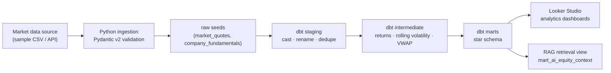

# Market Data Platform — a governed GCP data foundation for financial analytics and AI retrieval

Python ingestion → Google BigQuery → **dbt** (staging → intermediate → star-schema marts) → **Looker Studio**,
with marts that also feed a downstream **RAG retrieval view**.

[](https://github.com/koatedevopskpai/market-data-platform/actions/workflows/ci.yml)


> **Scope & status** — This is a portfolio project, built end to end and green in CI.
> Python ingestion + Pydantic validation, the full dbt DAG and its tests, Terraform and CI are implemented.
> The Looker Studio dashboard is documented in [`looker/dashboard_build.md`](looker/dashboard_build.md) with a build
> guide and screenshots. The pipeline runs locally on **DuckDB** (no cloud credentials required) and in production
> on **BigQuery**.

---

## Why this exists

Enterprise AI platforms sit on top of a data platform. RAG needs clean, modelled, governed data; evaluation needs
structured datasets. This repo is the **data foundation** — the layer beneath the analytics dashboards and the
retrieval pipelines — built with the same discipline: typed models, version-controlled transformations, tests as a
release gate, and cost-aware design.

## Architecture



```
                 ┌──────────────────────────────────────────────┐
                 │        Market Data Source (sample / API)     │
                 └──────────────────────┬───────────────────────┘
                                        │  Python + Pydantic v2
                                        ▼
                 ┌──────────────────────────────────────────────┐
                 │   raw seeds (BigQuery dataset / DuckDB)      │
                 └──────────────────────┬───────────────────────┘
                                        │
                                        ▼
                 ┌──────────────────────────────────────────────┐
                 │                dbt Core                      │
                 │  staging/      cast · rename · dedupe        │
                 │  intermediate/ returns · volatility · VWAP   │
                 │  marts/        Kimball star schema           │
                 └──────────────┬───────────────────────────────┘
                                │
        ┌───────────────────────┴────────────────────────┐
        ▼                                                ▼
┌──────────────────────┐                        ┌──────────────────────┐
│   Looker Studio      │                        │  AI / RAG layer      │
│   market overview    │                        │  mart_ai_equity_     │
│   trend · detail     │                        │  context (text+nums) │
└──────────────────────┘                        └──────────────────────┘
```

Full detail: [`docs/architecture.md`](docs/architecture.md).

## Stack

| Layer          | Tooling                                             |
| -------------- | --------------------------------------------------- |
| Ingestion      | Python 3.11, Pydantic v2                            |
| Warehouse      | Google BigQuery (local dev: DuckDB)                 |
| Transformation | dbt Core, `dbt_utils`                               |
| Serving        | Looker Studio (analytics) · RAG retrieval view (AI) |
| Infrastructure | Terraform (BigQuery datasets, GCS bucket, IAM)      |
| CI/CD          | GitHub Actions (ruff · pytest · dbt build/test)     |
| Auth           | Workload Identity Federation (keyless)              |

## Quickstart (local, no GCP account needed)

Requires Python 3.11 (dbt does not yet support 3.14).

```bash
make setup        # create .venv and install dev requirements
make ingest       # validate sample data, write dbt seeds
make dbt-local    # dbt deps + seed + build + test on DuckDB
make test         # ruff + pytest
```

`make dbt-local` runs the whole transformation DAG and its tests locally with the DuckDB adapter, so the project is
verifiable without cloud credentials.

## Running against BigQuery

```bash
export GCP_PROJECT=your-project-id
export GCP_DATASET=market_data
cd dbt_platform
cp profiles.yml.example profiles.yml     # then edit the bigquery target
dbt deps
dbt seed   --target bigquery
dbt build  --target bigquery
dbt docs generate --target bigquery
```

In CI, authentication uses Workload Identity Federation — no long-lived JSON keys.

## dbt DAG

| Layer        | Model(s)                                                                     | Materialisation |
| ------------ | ---------------------------------------------------------------------------- | --------------- |
| staging      | `stg_market_quotes`, `stg_company_fundamentals`                              | view            |
| intermediate | `int_daily_price_metrics` (daily return, rolling 30d volatility, VWAP)       | view            |
| marts        | `fct_daily_market_performance`, `dim_instruments`, `mart_ai_equity_context`  | table           |

`fct_daily_market_performance` is partitioned by `trade_date` and clustered by `ticker` on BigQuery to keep queries
cost-efficient (FinOps). Schema tests (`unique`, `not_null`, `accepted_values`, `relationships`) run in CI as a
deploy-blocking gate.

## Project layout

```
market-data-platform/
├── src/ingestion/        # Python: Pydantic models, source fetch, BigQuery load
├── tests/                # pytest
├── dbt_platform/         # dbt project: seeds, staging/intermediate/marts, tests
├── infra/                # Terraform: BigQuery, GCS, IAM
├── looker/               # Looker Studio build guide + screenshots
└── docs/                 # architecture + ADRs
```

## Data

`data/sample/` contains clearly-labelled **synthetic** market data (no real market feed) so the project runs
offline. Swap `--source` in `src/ingestion/fetch_market_data.py` to point at a real feed (the loader interface is the
same).

## Licence

MIT — see [LICENSE](LICENSE).
